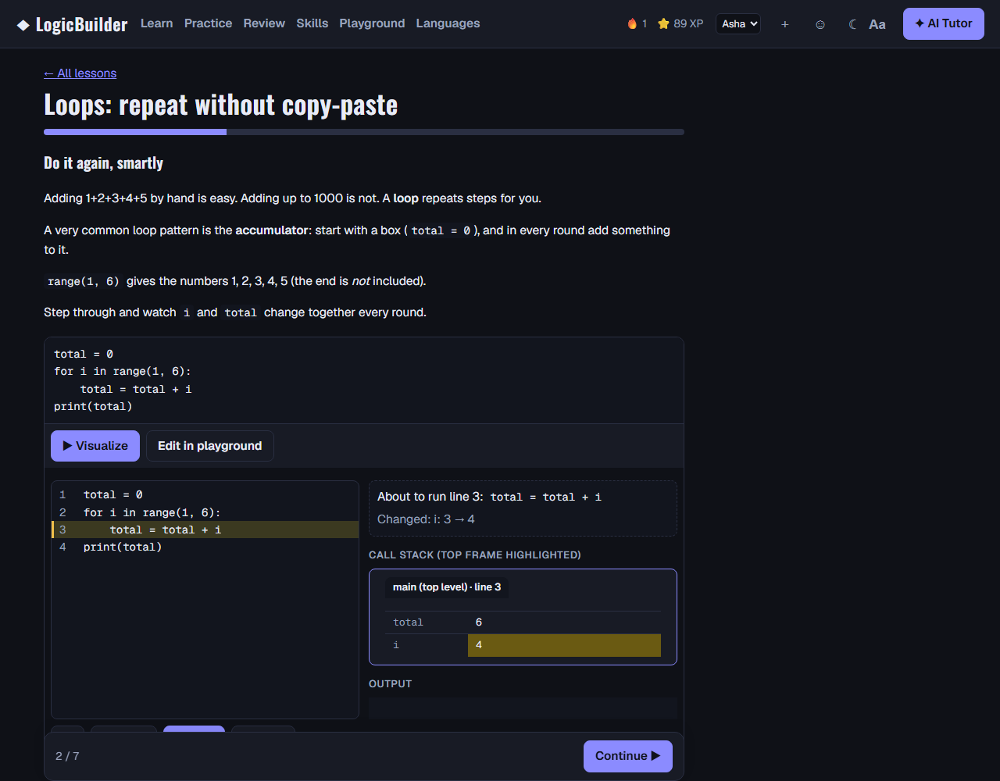
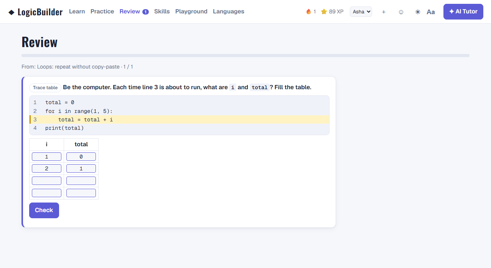
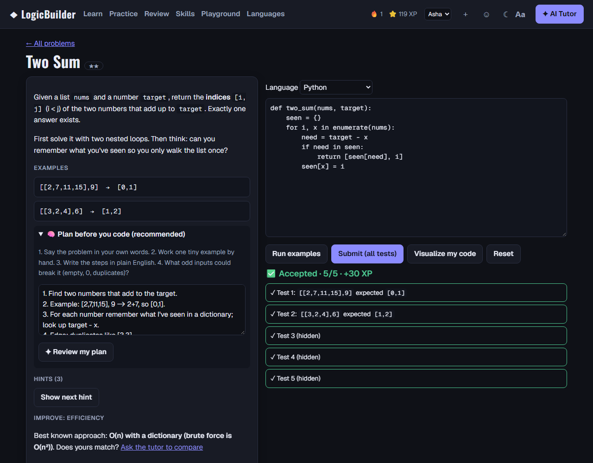
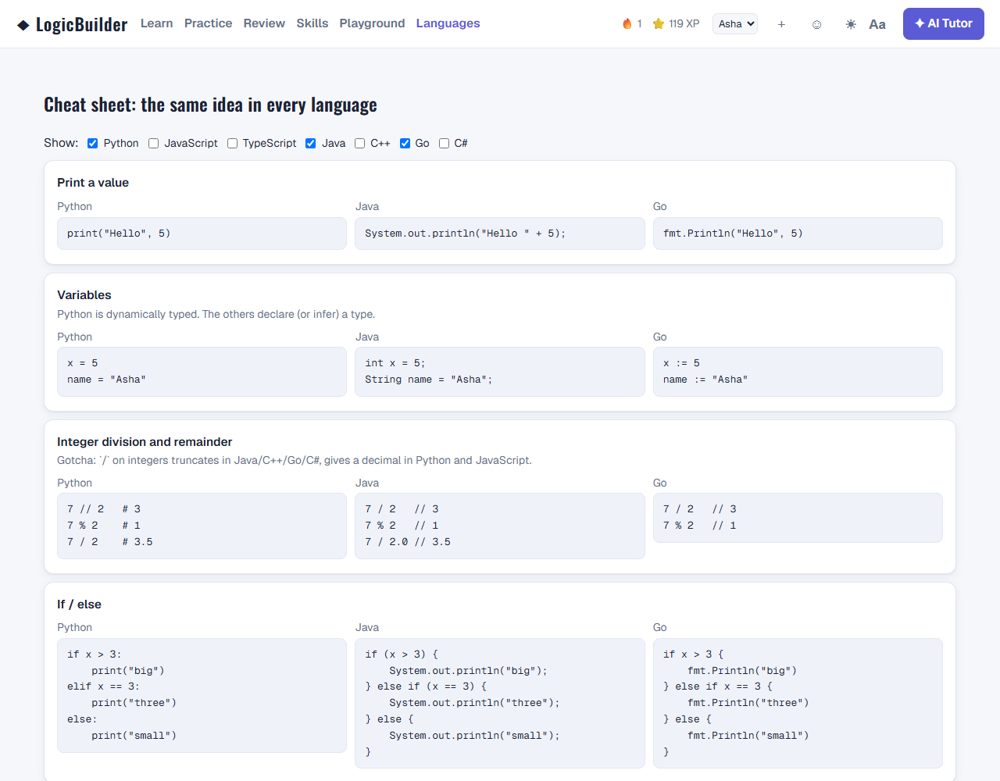
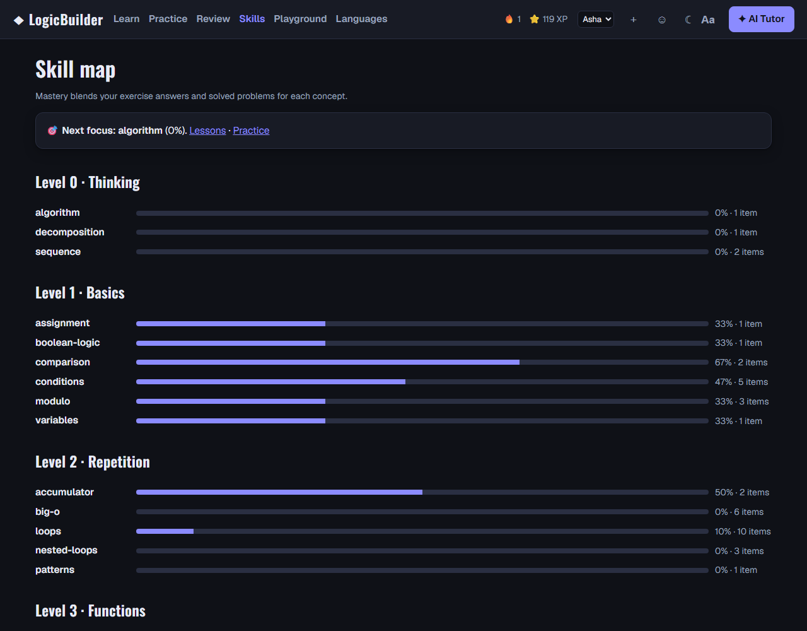
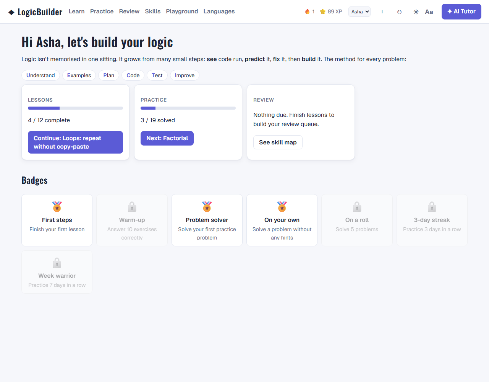

<div align="center">

# LogicBuilder

**Learn to think like a programmer: watch code run, predict it, fix it, then build it.**

A free, offline-first learning app that takes you from *"what is a variable?"* to solving interview-style DSA problems, with a step-by-step code visualizer, six kinds of interactive exercises, practice in 7 languages, and an AI tutor that guides instead of giving answers.

[](https://github.com/abhay-error/LogicBuilder/actions/workflows/ci.yml)
[](LICENSE)




</div>

## Why LogicBuilder?

Most tutorials teach syntax, then throw interview problems at you. The skill in between, **logic building**, is learned by seeing what code does, predicting it, debugging it and planning before typing. LogicBuilder is built around that loop:

**See → Predict → Fix → Build → Review**

- **Nothing to install, nothing to sign up for.** `python3 server.py` and your browser opens. No npm, no pip, no database, no account. Works offline.
- **Your code runs for real.** The visualizer traces actual execution, so what you see is what Python did.
- **Answers are computed, not guessed.** Exercise answers come from running the code and are graded on the server.
- **The AI tutor won't do your homework.** It sees your lesson, plan, code and test results and answers with hints and questions. Use local open models (Qwen, Gemma, DeepSeek via Ollama) or cloud (Kimi via OpenRouter).

## Screenshots

| Interactive exercises + spaced-repetition review | Practice problems with a plan step and hidden tests |
|:--:|:--:|
|  |  |

| Cross-language cheat sheet | Skill map and dark mode |
|:--:|:--:|
|  |  |

<details>
<summary>Home dashboard (light theme)</summary>

</details>

## Quick start

| OS | Start |
|---|---|
| Windows | double-click `start.bat` |
| macOS | `chmod +x start.sh start.command` once, then double-click `start.command` (or `bash start.sh`) |
| Linux | `bash start.sh` |
| Any | `python3 server.py` (options: `--port 9000`, `--no-browser`, or env `PORT`) |

Needs only **Python 3.9+**. Your browser opens at http://127.0.0.1:8000. The server listens on localhost only.

## Features

- **12 lessons** (levels 0-5), played one small step at a time, each with a **step-by-step visualizer**: call stack, list cells with pointer labels (`i`, `j`, `mid`), dictionaries and output. **Predict mode** asks you to guess the next value first.
- **6 exercise types**: quick check, predict the output, fill the blank, put the lines in order, trace table, find the bug.
- **19 practice problems** from Even/Odd to Binary Search and Max Subarray, with hidden tests, a 3-level hint ladder, a *Plan before you code* box and a complexity note.
- **7 languages**: Python, JavaScript, TypeScript, Java, C++, Go, C#. Starter code and test harnesses are generated from one typed signature per problem. A Languages page covers which language suits which interview, and a cheat sheet shows the same idea in each (integer division, overflow, sorting, hash maps...).
- **Spaced-repetition review**, a **skill map** of mastery per concept, badges, XP and streaks.
- **Light / dark / auto theme** and font choices (Geist Mono, Fira Mono, Fira Code, JetBrains Mono, Oswald), all bundled for offline use.
- **Multiple learner profiles**, data export, and groundwork for a paid product (plans, a server-enforced paywall, an admin analytics page). See [docs/03-PRODUCT-AND-BUSINESS.md](docs/03-PRODUCT-AND-BUSINESS.md).

## Your progress is saved per learner

Use the learner menu in the top bar (the **+** adds a learner). Everything is stored on the server side in `data/users/<name>.json`, not in the browser, so clearing your browser or opening another one loses nothing:

- completed lessons, solved problems, XP, streaks, badges, review schedule
- **where you stopped in a lesson**, and which exercises you already answered
- your code drafts for every problem and language, your written plans, and your playground code
- your language choice, and who used the app last

A backup of the previous version is kept next to each file; if a file is ever damaged it is set aside (`*.corrupt-*.json`) and the backup is loaded instead. To move your progress to another computer, copy the `data/` folder. There are no passwords: profiles are for separating learners on one machine, not for security.

## Languages: what you need installed

Python needs nothing. For the others, install the toolchain, then restart or press **Re-scan** on the Languages page. Missing ones show an install command for your OS.

| Language | Windows | macOS | Linux |
|---|---|---|---|
| JavaScript / TypeScript | `winget install OpenJS.NodeJS.LTS` (Node 22.6+ for TypeScript) | `brew install node` | `apt install nodejs` |
| Java | `winget install EclipseAdoptium.Temurin.21.JDK` | `brew install openjdk` | `apt install default-jdk` |
| C++ | `winget install BrechtSanders.WinLibs.POSIX.UCRT` | `xcode-select --install` | `apt install g++` |
| Go | `winget install GoLang.Go` | `brew install go` | `apt install golang-go` |
| C# | `winget install Microsoft.DotNet.SDK.8` | `brew install --cask dotnet-sdk` | `apt install dotnet-sdk-8.0` |

Windows note: with *Smart App Control* enabled, Windows refuses to run unsigned programs, which includes anything you compile yourself (C++, Go, C#). LogicBuilder detects this and tells you. Python, JavaScript, TypeScript and Java are unaffected, and everything works on macOS, Linux and WSL.

## AI tutor

Open the **AI Tutor** panel and pick a model family and where it runs:

- **Local (Ollama)**: install https://ollama.com, then e.g. `ollama pull qwen2.5-coder:7b`, `ollama pull gemma3:4b`, `ollama pull deepseek-r1:8b`.
- **Cloud (OpenRouter)**: paste an API key under the gear icon, or set `OPENROUTER_API_KEY`. Use this for Kimi K2, which is too large for most PCs.

Model ids change often; edit them in the settings panel. Your key stays in `data/ai_config.json` on your machine (git-ignored).

## Roadmap

- [ ] Levels 6-7: trees, graphs, BFS/DFS, heaps, dynamic programming (lessons + visualizer renderers)
- [ ] More problems (target: 100+) and a contributor-friendly content format
- [ ] Visualizer for JavaScript
- [ ] C as an eighth language
- [ ] Hindi and other translations
- [ ] Optional hosted version: accounts, PostgreSQL, containerised code judge (designs in [docs/](docs/))

Pick something from the issues tagged **good first issue**, or open one to propose an idea.

## Tests

```
python tests/selftest.py    # content + engine: every reference solution must pass its tests
python tests/api_test.py    # server end to end, on a temporary data folder
python tests/lang_test.py   # all languages; a missing toolchain is reported as SKIP, never silently passed
```

GitHub Actions runs all three on Windows, macOS and Linux.

## Project layout

```
server.py            web server + REST API (stdlib only)
app/                 sandbox + tracer, multi-language runner, exercises, learning engine, store, AI client
content/             lessons, problems, signatures, cheat sheet (all data, no logic)
web/                 index.html, app.js, style.css, fonts/
tests/               selftest.py, api_test.py, lang_test.py
docs/                low-level design, high-level design, product notes, screenshots
data/                created at run time (progress, event log, AI settings); git-ignored
```

Adding a problem: add it to `content/problems.py` with a reference solution and one line to `content/signatures.py`; `selftest.py` checks it. See [CONTRIBUTING.md](CONTRIBUTING.md).

## Documentation

| File | Purpose |
|---|---|
| [docs/01-LOW-LEVEL-DESIGN.md](docs/01-LOW-LEVEL-DESIGN.md) | Modules, schemas, content formats, trace spec, APIs, algorithms, tests |
| [docs/02-HIGH-LEVEL-DESIGN.md](docs/02-HIGH-LEVEL-DESIGN.md) | Vision, curriculum, architecture, local vs production, risks |
| [docs/03-PRODUCT-AND-BUSINESS.md](docs/03-PRODUCT-AND-BUSINESS.md) | Teaching approach, monetisation, metrics, launch gaps, 90-day plan |

## Security

Local mode runs learner code on your machine with your own user rights. Do not expose this server to a network. See [SECURITY.md](SECURITY.md).

## Contributing

Lessons, problems, translations, bug reports and ideas are all welcome. Start with [CONTRIBUTING.md](CONTRIBUTING.md). If LogicBuilder helps you learn or teach, a star helps others find it.

## License

[MIT](LICENSE). Bundled fonts are under the SIL Open Font License; see [web/fonts/NOTICE.md](web/fonts/NOTICE.md).
