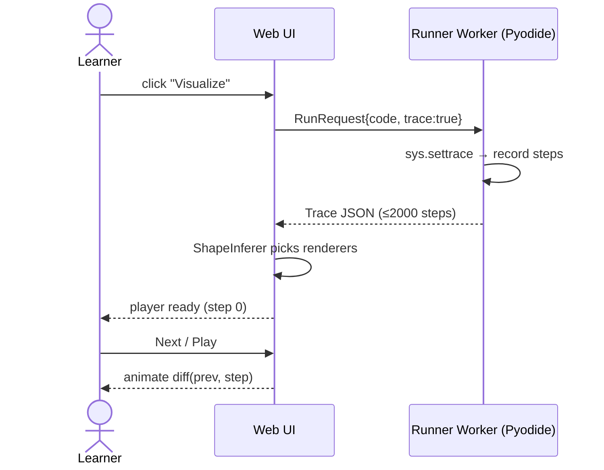
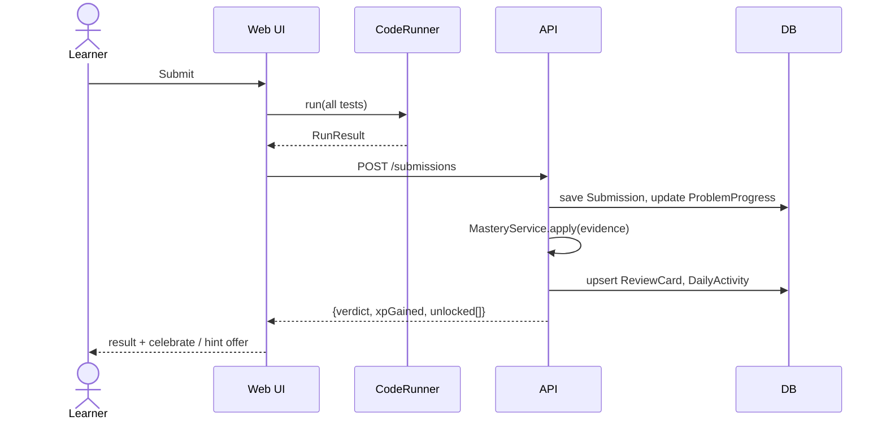
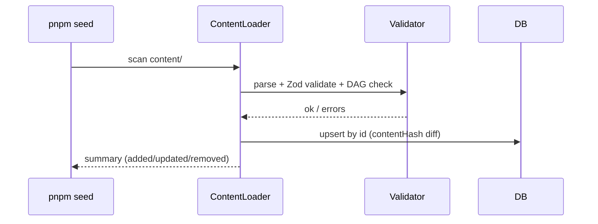

# LogicBuilder — Low-Level Design (LLD)

Version 1.0 · Status: Draft · Companion: [02-HIGH-LEVEL-DESIGN.md](02-HIGH-LEVEL-DESIGN.md)

LogicBuilder is a learning platform that takes a person from zero coding knowledge to confident problem solver through concept lessons, step-by-step visual execution of code, and graded DSA practice. This document specifies *how* it is built: modules, schemas, APIs, classes, algorithms. The HLD explains *why* and the overall shape.

---

## 1. Technology decisions (ADRs)

| # | Decision | Local MVP | Production path | Rationale |
|---|----------|-----------|-----------------|-----------|
| ADR-1 | Frontend | React 18 + TypeScript + Vite | Same, served via CDN | Type safety, fast dev loop, rich ecosystem for SVG/canvas visuals |
| ADR-2 | Backend | Node 20 + Fastify + TypeScript | Same, horizontally scaled | Shares types with frontend; Fastify is fast and schema-driven |
| ADR-3 | DB | SQLite via Prisma | PostgreSQL via Prisma | Zero-setup locally; schema portable (avoid SQLite-only features) |
| ADR-4 | Code execution | In-browser: Pyodide (Python), Web Worker sandbox (JS) | Isolated judge workers (Docker/gVisor) behind a queue | No server risk locally; production needs trusted verdicts |
| ADR-5 | Content | Markdown + YAML frontmatter + JSON in repo, loaded into DB at seed time | Same + CMS/admin UI optional | Versionable, reviewable, portable |
| ADR-6 | Visualization | Execution trace JSON → React SVG renderers | Same; traces may be precomputed or generated on demand | Decouples *what happened* from *how it is drawn* |
| ADR-7 | Auth | Single local profile (no login) | OAuth + email, JWT sessions | Keep local simple; interface `AuthProvider` hides the difference |
| ADR-8 | State | Zustand (UI) + TanStack Query (server cache) | Same | Minimal boilerplate, clear separation of client vs server state |
| ADR-9 | Validation | Zod schemas shared between FE/BE | Same | One source of truth for types and runtime checks |
| ADR-10 | Monorepo | pnpm workspaces | Same (+ Turborepo) | Share `packages/types`, `packages/trace-engine` |

---

## 2. Repository structure

```
LogicBuilder/
├─ docs/                          # this file, HLD
├─ apps/
│  ├─ web/                        # React frontend
│  │  └─ src/
│  │     ├─ app/                  # router, providers, layout
│  │     ├─ features/
│  │     │  ├─ curriculum/        # track/module/lesson browsing
│  │     │  ├─ lesson/            # lesson player (text + visuals + quiz)
│  │     │  ├─ visualizer/        # trace player + renderers
│  │     │  ├─ playground/        # editor + run
│  │     │  ├─ practice/          # DSA problem list, solver, submissions
│  │     │  ├─ progress/          # dashboard, streaks, review queue
│  │     │  └─ settings/
│  │     ├─ shared/               # ui kit, hooks, api client, utils
│  │     └─ workers/              # runner workers (python, js)
│  └─ api/                        # Fastify backend
│     └─ src/
│        ├─ routes/               # HTTP layer (thin)
│        ├─ controllers/
│        ├─ services/             # business logic
│        ├─ repositories/         # DB access (Prisma)
│        ├─ runners/              # CodeRunner strategies (server side)
│        ├─ content/              # content loader/seeder
│        └─ plugins/              # auth, logging, error handler
├─ packages/
│  ├─ types/                      # Zod schemas + inferred TS types
│  ├─ trace-engine/               # tracer, trace schema, step recorder
│  └─ content-schema/             # lesson/problem validators (CLI lint)
├─ content/
│  ├─ tracks/<track>/<module>/<lesson>.md
│  ├─ problems/<slug>/{problem.md, tests.json, solutions/, hints.md}
│  └─ traces/<lesson-id>/<n>.trace.json      # optional precomputed
├─ prisma/schema.prisma
└─ tests/ (e2e)
```

**Layering rule (backend):** `routes → controllers → services → repositories`. Only repositories touch Prisma. Services never import Fastify types. This makes swapping SQLite→Postgres or Fastify→anything local.

**Feature rule (frontend):** features may import from `shared/`, never from each other. Cross-feature needs go through `shared/` or router state.

---

## 3. Domain model and database schema

### 3.1 Entities

```
Track 1─* Module 1─* Lesson *─* Concept
Lesson 1─* Exercise (quiz / predict-output / fill-blank / reorder)
Concept *─* Problem        (a problem trains concepts)
Problem 1─* TestCase
Problem 1─* Hint (ladder)
User 1─* Submission *─1 Problem
User 1─* LessonProgress
User 1─* ProblemProgress
User 1─* ReviewCard (spaced repetition)  → refers to Concept or Problem
User 1─* DailyActivity (streaks)
```

### 3.2 Prisma schema (portable subset)

```prisma
datasource db { provider = "sqlite" url = env("DATABASE_URL") } // postgresql in prod
generator client { provider = "prisma-client-js" }

model User {
  id          String   @id @default(cuid())
  displayName String
  email       String?  @unique        // null for local profile
  createdAt   DateTime @default(now())
  prefs       String   @default("{}") // JSON string (use Json type on Postgres)
  lessonProgress  LessonProgress[]
  problemProgress ProblemProgress[]
  submissions     Submission[]
  reviewCards     ReviewCard[]
  activity        DailyActivity[]
}

model Track {
  id String @id            // e.g. "foundations"
  title String
  description String
  order Int
  modules Module[]
}

model Module {
  id String @id            // "foundations.loops"
  trackId String
  title String
  order Int
  track Track @relation(fields: [trackId], references: [id])
  lessons Lesson[]
}

model Lesson {
  id String @id            // "foundations.loops.for-loop"
  moduleId String
  slug String
  title String
  order Int
  estMinutes Int
  contentHash String       // detect content changes on re-seed
  body String              // markdown
  module Module @relation(fields: [moduleId], references: [id])
  exercises Exercise[]
  concepts LessonConcept[]
  progress LessonProgress[]
  @@unique([moduleId, slug])
}

model Exercise {
  id String @id
  lessonId String
  kind String              // "mcq" | "predict_output" | "fill_blank" | "reorder" | "trace_step"
  prompt String
  payload String           // JSON: options/answer/explanation
  lesson Lesson @relation(fields: [lessonId], references: [id])
}

model Concept {
  id String @id            // "loops", "recursion", "two-pointers"
  title String
  kind String              // "fundamental" | "data-structure" | "algorithm" | "pattern"
  prereqs ConceptPrereq[] @relation("concept")
  lessons LessonConcept[]
  problems ProblemConcept[]
}
model ConceptPrereq {
  conceptId String
  prereqId  String
  concept Concept @relation("concept", fields: [conceptId], references: [id])
  @@id([conceptId, prereqId])
}
model LessonConcept  { lessonId String  conceptId String  @@id([lessonId, conceptId])
  lesson Lesson @relation(fields:[lessonId], references:[id])
  concept Concept @relation(fields:[conceptId], references:[id]) }
model ProblemConcept { problemId String conceptId String @@id([problemId, conceptId])
  problem Problem @relation(fields:[problemId], references:[id])
  concept Concept @relation(fields:[conceptId], references:[id]) }

model Problem {
  id String @id
  slug String @unique
  title String
  difficulty Int           // 1..5
  statement String         // markdown
  starterCode String       // JSON {python:"...", javascript:"..."}
  timeLimitMs Int @default(2000)
  memoryLimitMb Int @default(128)
  expectedComplexity String // e.g. "O(n log n)"
  tests TestCase[]
  hints Hint[]
  concepts ProblemConcept[]
  submissions Submission[]
}
model TestCase {
  id String @id @default(cuid())
  problemId String
  input String             // JSON-encoded args
  expected String          // JSON-encoded
  isSample Boolean @default(false)   // visible to learner
  weight Int @default(1)
  problem Problem @relation(fields:[problemId], references:[id])
}
model Hint {
  id String @id @default(cuid())
  problemId String
  level Int                // 1 nudge, 2 approach, 3 pseudocode, 4 solution outline
  text String
  problem Problem @relation(fields:[problemId], references:[id])
  @@unique([problemId, level])
}

model Submission {
  id String @id @default(cuid())
  userId String
  problemId String
  language String
  code String
  verdict String           // "AC" | "WA" | "TLE" | "RE" | "CE" | "MLE"
  passed Int
  total Int
  runtimeMs Int?
  createdAt DateTime @default(now())
  user User @relation(fields:[userId], references:[id])
  problem Problem @relation(fields:[problemId], references:[id])
  @@index([userId, problemId, createdAt])
}

model LessonProgress {
  userId String
  lessonId String
  status String            // "not_started" | "in_progress" | "completed"
  lastStep Int @default(0)
  completedAt DateTime?
  user User @relation(fields:[userId], references:[id])
  lesson Lesson @relation(fields:[lessonId], references:[id])
  @@id([userId, lessonId])
}
model ProblemProgress {
  userId String
  problemId String
  status String            // "unseen" | "attempted" | "solved"
  attempts Int @default(0)
  hintsUsed Int @default(0)
  firstSolvedAt DateTime?
  user User @relation(fields:[userId], references:[id])
  @@id([userId, problemId])
}
model ReviewCard {
  id String @id @default(cuid())
  userId String
  refType String           // "concept" | "problem"
  refId String
  ease Float @default(2.5)
  intervalDays Int @default(0)
  repetitions Int @default(0)
  dueAt DateTime
  user User @relation(fields:[userId], references:[id])
  @@unique([userId, refType, refId])
  @@index([userId, dueAt])
}
model DailyActivity {
  userId String
  day String               // YYYY-MM-DD (user local)
  minutes Int @default(0)
  xp Int @default(0)
  user User @relation(fields:[userId], references:[id])
  @@id([userId, day])
}
```

Portability notes: JSON stored as `String` locally; migrate columns to `Json` on Postgres. No SQLite-specific SQL. IDs are strings (cuid) so merging local → cloud data is feasible.

---

## 4. Content formats

### 4.1 Lesson file (`content/tracks/foundations/loops/for-loop.md`)

```markdown
---
id: foundations.loops.for-loop
title: The for loop — doing things again
estMinutes: 12
concepts: [loops, iteration]
prereqs: [foundations.variables.assignment]
visuals: [for-loop-sum]        # trace ids used in the lesson
---

## Why loops?
Imagine writing "hello" 100 times...

:::visual id=for-loop-sum autoplay=false
:::

:::exercise kind=predict_output
prompt: What is printed?
code: |
  total = 0
  for i in range(3):
      total += i
  print(total)
answer: "3"
explanation: i takes 0,1,2 so total = 0+1+2.
:::
```

Custom directives (`:::visual`, `:::exercise`, `:::callout`) are parsed by a remark plugin in `packages/content-schema` and validated by Zod. A CLI `pnpm content:lint` fails the build on broken references, missing prereqs, or invalid traces.

### 4.2 Problem folder

```
content/problems/two-sum/
  problem.md        # frontmatter: id, title, difficulty, concepts, expectedComplexity; body: statement
  tests.json        # [{input:[[2,7,11,15],9], expected:[0,1], isSample:true}, ...]
  hints.md          # "## 1", "## 2", ... one section per hint level
  solutions/
    brute.py        # O(n^2) – referenced in "compare approaches" view
    optimal.py      # O(n) hash map
```

---

## 5. Visualization engine (core differentiator)

### 5.1 Concept

Code never draws itself. Code execution produces a **Trace** (ordered list of steps with state snapshots/deltas). A **Renderer** turns a step into pixels. This lets us: replay forward/back, scrub, precompute for production, test with plain JSON, and add new data-structure renderers independently.

### 5.2 Trace schema (`packages/trace-engine`)

```ts
type Value =
  | { t: "int"|"float"|"bool"|"str"|"none"; v: string|number|boolean|null }
  | { t: "list"|"tuple"|"set"; id: string; items: Value[] }
  | { t: "dict"; id: string; entries: [Value, Value][] }
  | { t: "ref"; id: string }                   // pointer to heap object (for linked lists, trees, graphs)
  | { t: "obj"; id: string; cls: string; fields: Record<string, Value> };

interface Frame { fn: string; line: number; locals: Record<string, Value>; }

interface Step {
  i: number;                  // step index
  line: number;               // source line about to execute / just executed
  event: "line"|"call"|"return"|"exception"|"compare"|"swap"|"output";
  stack: Frame[];             // call stack (bottom → top)
  heap: Record<string, Value>;// objects by id (enables aliasing visuals)
  stdout?: string;            // cumulative or delta
  annotation?: string;        // plain-English narration, optional/authored or generated
  highlights?: Highlight[];   // e.g. {target:"arr", index:3, kind:"compare"}
}

interface Trace { version: 1; language: "python"|"javascript"; source: string; steps: Step[]; truncated: boolean; }
```

Limits (enforced by the tracer): max 2 000 steps, max 50 frames, max 200 elements per container displayed (rest summarized as "… +N more"). If exceeded: `truncated=true` and UI says so.

### 5.3 Producing traces

| Mode | Where | How |
|------|-------|-----|
| Python live | Browser (Pyodide) | `sys.settrace` hook inside the worker records `line/call/return` events, snapshots locals through a safe serializer (`serialize(value, depth, seen)`) |
| JS live | Browser worker | Source instrumented via AST transform (acorn + astring) inserting `__t(line, {vars})` calls |
| Precomputed | Repo `content/traces/` | Generated offline by the same tracer, reviewed, shipped as JSON → deterministic lessons, zero runtime cost |
| Authored | Repo | Hand-written trace for conceptual diagrams (e.g., flowchart-style "thinking" lessons) with `annotation` text |

### 5.4 Renderer interface

```ts
interface Renderer<V = unknown> {
  id: string;                                // "array", "linked-list", "tree", "graph", "call-stack", "variables", "flowchart", "grid"
  canRender(step: Step, focus: string): boolean;
  render(props: { step: Step; prev?: Step; focus: string; theme: Theme }): JSX.Element;
}
```

Registry: `rendererRegistry.register(new ArrayRenderer())`. A **VisualizerShell** component lays out panes: code (Monaco/CodeMirror with current-line highlight), variables/heap, call stack, data-structure canvas, narration, controls.

Detection of what to draw: a `ShapeInferer` inspects heap objects (list of ints → array bars; objects with `next` → linked list; with `left/right` → binary tree; dict of lists → adjacency graph; list of lists → grid). Lesson authors can override with `:::visual focus=arr as=array`.

### 5.5 Player controls and state

```ts
interface PlayerState { traceId: string; index: number; playing: boolean; speed: 0.5|1|2|4; breakpoints: Set<number>; }
```

Actions: `next, prev, seek(i), play, pause, setSpeed, toggleBreakpoint(line), jumpToNextCall()`. Animations use CSS transitions keyed on diffs between `prev` and `step` (value change, swap, pointer move). Respect `prefers-reduced-motion`.

### 5.6 "Learn by prediction" mode
Before revealing the next step, player may ask "what will `total` be after this line?" (multiple choice generated from the true next value plus distractors). Result feeds mastery (§7).

---

## 6. Code execution subsystem

### 6.1 Strategy interface (shared by local and production)

```ts
interface RunRequest { language: Lang; code: string; tests: {input: unknown[]; expected: unknown}[]; entry: string; limits: {timeMs: number; memoryMb: number}; trace?: boolean; }
interface RunResult { verdict: "AC"|"WA"|"TLE"|"RE"|"CE"|"MLE"; results: {pass: boolean; actual?: unknown; stderr?: string; ms: number}[]; stdout: string; trace?: Trace; }

interface CodeRunner { run(req: RunRequest): Promise<RunResult>; }
```

Implementations:
- `PyodideWorkerRunner` (browser, local MVP)
- `JsWorkerRunner` (browser)
- `RemoteJudgeRunner` (production; POSTs to judge queue, polls/WS for result)

The frontend `RunnerFactory` selects by `config.runnerMode = "local" | "remote"`. Problem solving code is identical in both modes; only the factory differs.

### 6.2 Test harness convention
Learners write a function (`def two_sum(nums, target):`). The harness imports it, calls with decoded JSON args, compares via a deterministic comparator (`exact`, `unordered`, `float_eps`, `custom checker id`). stdout is captured and capped (64 KB).

### 6.3 Safety (local)
Web Worker with no DOM; terminated on timeout (`worker.terminate()`); output size cap; no network from Pyodide (blocked by CSP `connect-src` except Pyodide CDN or bundled copy). Infinite-loop protection = wall-clock watchdog in the main thread.

### 6.4 Safety (production, summarised; details in HLD)
Containers per run, no network, read-only FS, cgroup CPU/mem limits, seccomp, pids limit, ephemeral, queue with per-user rate limits.

---

## 7. Learning engine

### 7.1 Concept graph and prerequisites
`Concept` + `ConceptPrereq` form a DAG (validated at seed time: no cycles — Kahn's algorithm). Lessons and problems attach to concepts. This graph drives unlocking and recommendations.

### 7.2 Mastery model
Per `(user, concept)` mastery `m ∈ [0,1]`, updated on evidence:

```
evidence weights:
  lesson exercise correct   +0.05 (first try) / +0.02 (after retry)
  prediction correct        +0.03
  problem solved no hints   +0.15 * difficulty/3
  problem solved w/ hints   +0.08 * difficulty/3 * (1 - 0.2*hintsUsed)
  wrong submission          -0.01 (floor 0)
update: m = clamp(m + weight, 0, 1)
unlocked(concept) = all prereqs have m >= 0.6
```
Simple, explainable, tunable constants in `config/mastery.ts`. (Upgrade path: Bayesian Knowledge Tracing — interface `MasteryModel` allows swap.)

### 7.3 Recommendation ("what next?")
```
candidates = problems whose concepts are all unlocked AND not solved
score(p) = 0.5 * fit(p) + 0.3 * weakness(p) + 0.2 * variety(p)
 fit      = 1 - |difficulty(p) - targetDifficulty(user)| / 4
 weakness = mean(1 - mastery(c)) for c in p.concepts
 variety  = 1 if p's concepts differ from last 3 attempted else 0.3
targetDifficulty = clamp(round(avg difficulty of last 5 solved w/o hints) + 1, 1, 5)
```
Return top 5; always include one "review" item if the due-card queue is non-empty.

### 7.4 Spaced repetition (SM-2 variant)
On review with quality `q ∈ {0..5}`:
```
if q < 3: repetitions = 0; intervalDays = 1
else:
  repetitions += 1
  intervalDays = repetitions==1 ? 1 : repetitions==2 ? 6 : round(intervalDays * ease)
ease = max(1.3, ease + 0.1 - (5-q)*(0.08 + (5-q)*0.02))
dueAt = now + intervalDays
```
Cards are created when a concept is first completed or a problem is solved with hints.

### 7.5 Hint ladder
Hint level n is unlocked after `n * 3` minutes on the problem OR after n failed submissions, or immediately on explicit click (counts toward `hintsUsed`). Levels: 1 nudge → 2 approach idea → 3 pseudocode → 4 solution outline. Full solution viewable only after 4 hints or a solve.

### 7.6 Streaks and XP
`DailyActivity` rows; streak = consecutive days with `minutes>=5 OR xp>0`, computed server-side with the user's timezone offset stored in prefs. XP: lesson 10, exercise 2, problem `10*difficulty`, no-hint bonus +50%.

---

## 8. REST API

Base `/api/v1`. JSON. All responses validated with Zod. Errors use one envelope:

```json
{ "error": { "code": "PROBLEM_NOT_FOUND", "message": "…", "details": {} } }
```
Codes map to HTTP: 400 `VALIDATION_ERROR`, 401 `UNAUTHENTICATED`, 403 `FORBIDDEN`, 404 `*_NOT_FOUND`, 409 `CONFLICT`, 429 `RATE_LIMITED`, 500 `INTERNAL`.

| Method & path | Purpose | Notes |
|---|---|---|
| GET `/tracks` | list tracks with modules and per-user completion % | cached |
| GET `/modules/:id/lessons` | lessons + status | |
| GET `/lessons/:id` | lesson body, exercises (without answers), visual refs | answers checked server-side |
| POST `/lessons/:id/progress` | `{status, lastStep}` | idempotent |
| POST `/exercises/:id/answer` | `{answer}` → `{correct, explanation}` | updates mastery |
| GET `/traces/:id` | precomputed trace JSON | immutable, long cache (ETag) |
| GET `/problems?difficulty=&concept=&status=&q=&cursor=` | paginated list | cursor pagination |
| GET `/problems/:slug` | statement, sample tests, starter code | hides non-sample tests |
| POST `/problems/:slug/submissions` | `{language, code, verdictClaim?}` | local mode: client posts result of local run (trusted); prod: server runs/judges |
| GET `/problems/:slug/submissions` | history | |
| POST `/problems/:slug/hints/:level` | reveal hint, increments `hintsUsed` | |
| GET `/me/progress` | dashboard: mastery per concept, streak, xp, recent | |
| GET `/me/recommendations` | next problems/lessons | |
| GET `/me/reviews/due` / POST `/me/reviews/:id` | spaced repetition queue / grade `{quality}` | |
| GET `/concepts/graph` | DAG for the skill-map visual | |

Production additions: `/auth/*`, `/admin/content/*`, WebSocket `/ws/submissions/:id` for judge results.

**Local-mode trust note:** because the user is the only user, verdicts from the in-browser runner are accepted. In production the server is the only source of verdicts (`RemoteJudgeRunner`); the endpoint contract stays the same, the server ignores any client verdict.

---

## 9. Frontend design

### 9.1 Routes
```
/                      home / continue where you left off
/learn                 track map (skill tree)
/learn/:track/:module/:lesson     lesson player
/visualize             free-form visualizer (paste code → trace)
/practice              problem list with filters
/practice/:slug        solver: statement | editor | tests | hints | submissions | compare approaches
/progress              dashboard, skill map, streak, review queue
/settings
```

### 9.2 Key components
- `LessonPlayer`: sequences blocks (markdown, `VisualizerShell`, `Exercise`), saves `lastStep` on change (debounced 1 s).
- `VisualizerShell` (see §5) — pure, takes a `Trace`.
- `CodeEditor`: CodeMirror 6 (lighter than Monaco), line highlight extension fed by player state.
- `ProblemSolver`: split pane; Run (sample tests, shows per-test diff) vs Submit (all tests).
- `SkillMap`: SVG DAG of concepts, colored by mastery, locked nodes greyed.
- `ApproachCompare`: shows brute vs optimal trace side-by-side with step counts, making complexity tangible ("n=8: 28 vs 8 steps").

### 9.3 State
- Server data: TanStack Query, keys `['problem', slug]`, stale time long for content, short for progress.
- UI state: Zustand slices (`playerSlice`, `editorSlice`, `settingsSlice`). Editor drafts persisted to `localStorage` per `(problem, language)`.

### 9.4 Accessibility and UX rules
Keyboard controls for the player (←/→ step, space play), ARIA live region announcing narration, color-blind-safe palette plus shape/label cues (never color alone), reduced motion, dark/light theme, min contrast 4.5:1, mobile-readable lessons (editor features degrade gracefully).

### 9.5 Performance
Route-level code splitting; Pyodide and renderers lazy loaded; Pyodide cached via service worker; virtualized problem list; memoized renderers keyed on step index; trace JSON gzip.

---

## 10. Cross-cutting concerns

- **Config:** `.env` validated by Zod at boot (`DATABASE_URL`, `PORT`, `RUNNER_MODE`, `LOG_LEVEL`). Fail fast.
- **Logging:** pino, JSON, request id per request, no code bodies at info level.
- **Error handling:** central Fastify error handler maps domain errors (`class DomainError {code,status}`) to the envelope; unexpected errors → 500 + log.
- **Security (even local):** Helmet-style headers, strict CSP, Zod validation on every input, parameterized queries (Prisma), size limits (code ≤ 64 KB), CORS locked to the web origin.
- **Migrations:** Prisma migrate; seed script `pnpm seed` runs content loader idempotently using `contentHash`.
- **Content loader algorithm:** walk `content/`, parse, validate, upsert by id, delete DB rows whose files are gone (soft-delete flag if progress exists), validate concept DAG, report diff.
- **i18n readiness:** content files may have `lang` suffix (`for-loop.hi.md`); UI strings in `en.json`; schema has `Lesson.lang` added in production phase.

---

## 11. Sequence diagrams

### 11.1 Run code with visualization (local)


### 11.2 Submit a solution

(Production: the API itself enqueues to the judge and returns `202` + submission id; UI follows over WebSocket.)

### 11.3 Content seeding


---

## 12. Testing strategy

| Level | Tooling | Focus |
|---|---|---|
| Unit | Vitest | mastery math, SM-2, recommender, trace serializer, comparators, shape inference |
| Contract | Zod + generated OpenAPI check | API responses match schema |
| Integration | Vitest + in-memory SQLite | services + repositories, content loader |
| Component | Testing Library | renderers given fixture traces (snapshot of SVG structure), player controls |
| E2E | Playwright | learn a lesson → predict → solve problem → see progress |
| Content | `pnpm content:lint` in CI | every problem's reference solutions pass all its tests; every lesson trace valid |
| Visual regression | Playwright screenshots | key renderers |
| Perf | Lighthouse CI | budgets: LCP < 2.5 s local, JS initial < 250 KB gz |

Rule: **every problem must ship with a passing reference solution** — enforced by CI.

---

## 13. Coding standards
TypeScript `strict`, ESLint + Prettier, no `any` without comment, small pure functions in services, dependency injection via constructor (no singletons) for testability, conventional commits, feature-folder boundaries enforced by `eslint-plugin-boundaries`.

---

## 14. Extensibility points (design for later)
- New language: implement `CodeRunner` + a tracer; add starter code in problem files.
- New visual: implement `Renderer`, register it, optionally extend `ShapeInferer`.
- New exercise kind: add Zod variant + `ExerciseView` component.
- Mastery model swap: implement `MasteryModel`.
- Auth: implement `AuthProvider` (local = fixed user).
- Multi-tenant/teacher features: add `Org`, `Class`, `Assignment` tables (no change to existing ones).

## 15. Known limitations (MVP)
Tracing is capped (2 000 steps); recursion with huge depth is truncated; JS tracing via instrumentation does not cover every language feature (async, generators → "not supported" message); client-trusted verdicts in local mode; one local user.
