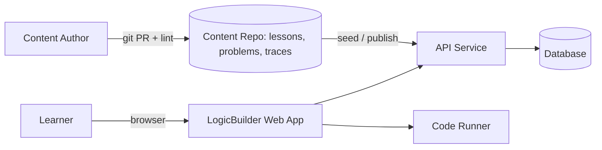
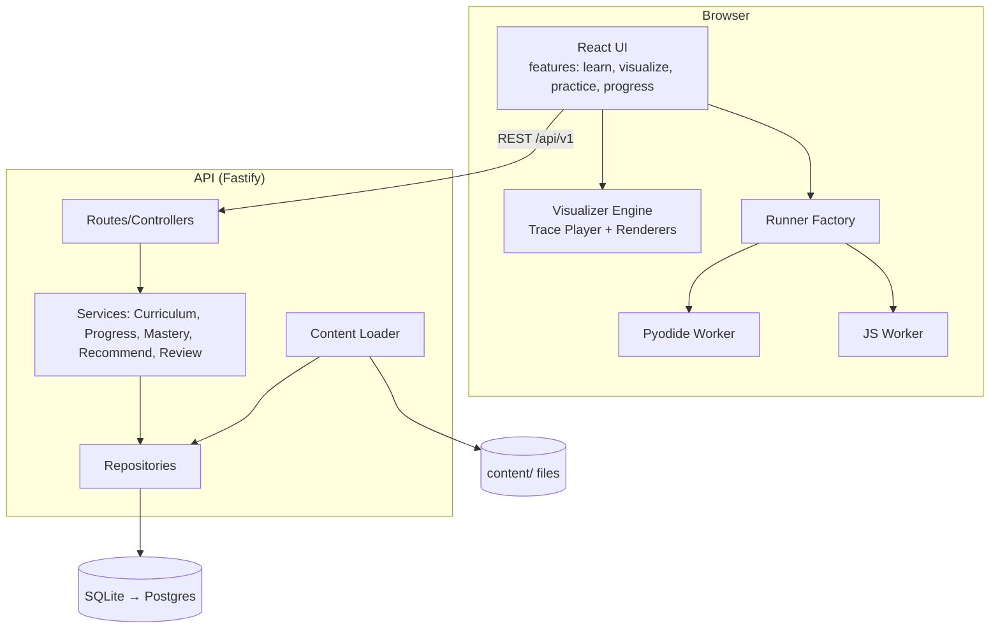
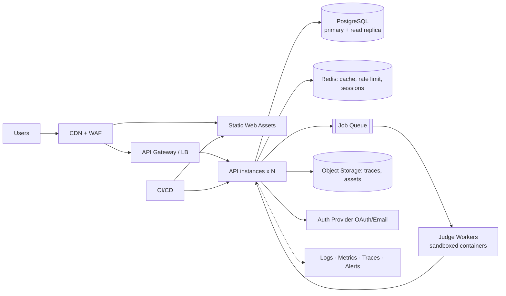

# LogicBuilder — High-Level Design (HLD)

Version 1.0 · Status: Draft · Companion: [01-LOW-LEVEL-DESIGN.md](01-LOW-LEVEL-DESIGN.md)

> Reading order note: the LLD was written first by request. Where this document names a component, the LLD section that details it is given as (LLD §n).

---

## 1. Vision and goals

**Vision:** Take anyone, including a person who has never written code, to a level where they can break a problem into logic, express it in code, and choose an efficient approach, through *seeing* what code does, not memorizing syntax.

**Goals**
1. Teach *logic building* first, syntax second (flowcharts, tracing, predicting).
2. Make every concept visual: step-by-step execution, variables, call stack, arrays, linked lists, trees, graphs.
3. Provide a graded DSA practice path with hints, complexity awareness and spaced review.
4. Run fully on localhost with zero cloud dependency.
5. Keep architecture such that a production deployment is an *evolution*, not a rewrite.

**Non-goals (v1):** live classrooms/video, social feeds, mobile native apps, languages beyond Python and JavaScript, AI tutor (reserved as a later extension).

## 2. Personas

| Persona | Starting point | Needs |
|---|---|---|
| Non-coder "Asha" | Never coded | Gentle pace, analogies, flowcharts, zero setup, no jargon |
| Beginner "Ravi" | Knows syntax, cannot solve problems | Pattern thinking, guided hints, many small wins |
| Interview-prep "Meera" | Solves easy problems | Patterns, complexity analysis, timed practice, review queue |

## 3. Functional overview

| Capability | Description |
|---|---|
| Curriculum | Tracks → modules → lessons; each lesson = story + visual + quiz |
| Visual Explainer | Executes code step-by-step with synchronized drawings and plain-English narration |
| Playground | Write/run code, one-click "Visualize" |
| DSA Practice | Problems with tests, verdicts, hint ladder, approach comparison (brute vs optimal) |
| Adaptive Engine | Mastery per concept, unlocks, recommendations, spaced repetition |
| Progress | Streaks, XP, skill map, review queue |

## 4. Curriculum architecture (zero → hero)

Seven levels, each gated by concept mastery (LLD §7).

| Level | Theme | Key concepts | Visual focus | Sample practice |
|---|---|---|---|---|
| 0 | Thinking like a computer | Instructions, sequence, inputs/outputs, flowcharts, pseudocode | Flowchart walkthrough, "robot on a grid" | Make-tea algorithm, sort cards by hand |
| 1 | Programming basics | Variables, types, operators, I/O, conditions | Variables box animation, decision diamond | Even/odd, max of three, leap year |
| 2 | Repetition | while/for, nested loops, accumulators | Loop counter timeline | Sum 1..n, factorial, patterns (triangle), prime check |
| 3 | Functions & structure | Functions, scope, call stack, recursion intro | Call-stack frames | Fibonacci (loop vs recursion), GCD, power |
| 4 | Collections | Arrays/lists, strings, dictionaries/sets, 2-D grids | Array cells, hash buckets | Reverse array, palindrome, anagram, frequency count |
| 5 | Core DSA | Complexity (Big-O), sorting, searching, stacks, queues, linked lists, recursion & backtracking intro | Sorting bars, pointer moves | Binary search, valid parentheses, reverse linked list, merge sorted lists |
| 6 | Patterns & problem solving | Two pointers, sliding window, prefix sums, hashing, binary search on answer, trees, BFS/DFS, heaps, intro DP, greedy | Tree/graph traversal, DP table fill | Two Sum, max subarray, level-order traversal, number of islands, climbing stairs, coin change |
| 7 | Mastery | Mixed-pattern sets, timed mode, complexity justification, optimization drills | Approach compare view | Curated "interview 75"-style sets, mock rounds |

Each level ends with a **checkpoint**: a small mixed problem set; ≥ 70% unlocks the next level (override allowed, because learners should never be hard-blocked).

Teaching loop for every concept (the "SPEC" loop): **S**ee it (visual) → **P**redict it (what happens next?) → **E**xplain it (fill-blank/reorder) → **C**reate it (write code). Later, review via spaced repetition.

## 5. System context



## 6. Logical architecture



Key idea: **three independent engines** that can be developed and scaled separately:
1. **Content engine** (what to teach, as data)
2. **Visualization engine** (trace → drawing)
3. **Learning engine** (mastery, recommendations, review)
plus the **Execution subsystem** (run/judge code) behind one interface.

## 7. Key data flows

1. **Learn:** UI fetches lesson → renders markdown → loads trace (precomputed JSON) → player animates → exercise answered → API updates mastery.
2. **Practice:** UI loads problem → learner codes → Runner executes tests (local) → result posted → progress/mastery/review cards updated → recommendations refreshed.
3. **Visualize anything:** learner pastes code → worker traces → trace rendered; nothing leaves the browser.
4. **Publish content:** author edits files → `content:lint` (schema, DAG, reference solutions pass) → seed/publish.

## 8. Deployment views

### 8.1 Local (now)
```
Browser ⇄ localhost:5173 (Vite)  ⇄  localhost:3000 (Fastify)  ⇄  SQLite file
Code runs in browser workers. Start: `pnpm dev`.
```
Optionally a single-process mode: API serves the built frontend. No Docker needed.

### 8.2 Production target (future)


| Concern | Local | Production | Change required |
|---|---|---|---|
| DB | SQLite | Postgres | Connection string + `Json` columns (Prisma) |
| Runner | Browser workers | Judge queue | Switch `RunnerFactory` to `RemoteJudgeRunner` |
| Auth | Fixed local user | OAuth/JWT | Implement `AuthProvider` |
| Content | Files seeded at boot | Same + CMS/admin or CI publish | Add admin routes (optional) |
| Traces | Files/served by API | Object storage + CDN | Config only |
| Cache | In-memory | Redis | Cache adapter |

Because boundaries (Repository, CodeRunner, AuthProvider, CacheAdapter) are interfaces today (LLD §2, §6), the upgrade is configuration plus new adapters.

## 9. Non-functional requirements

| Area | Target (local MVP) | Target (production) |
|---|---|---|
| Performance | Page interactive < 2 s; step animation 60 fps; run sample tests < 1.5 s (excl. first Pyodide load) | p95 API < 200 ms; judge p95 < 3 s queue+run |
| Scalability | n/a (single user) | Stateless API scaled horizontally; judge pool autoscaled on queue depth; read-heavy content cached at CDN |
| Availability | n/a | 99.9%; graceful degrade: visual lessons work offline-ish from cached traces |
| Security | Strict CSP, input validation, worker sandbox | + sandboxed containers (no network, seccomp, cgroups), rate limiting, auth, secrets manager, dependency scanning, OWASP top-10 review |
| Privacy | All data local | Minimal PII, consent, export/delete account |
| Accessibility | WCAG 2.1 AA | Same + audits |
| Maintainability | Typed, tested, feature-foldered | + ADR log, CI gates |
| Portability | Windows/macOS/Linux with Node 20 | Containerized |
| Observability | Console logs | Structured logs, metrics (RED), tracing, alerting |

## 10. Scalability strategy (when going production)

- **Stateless API** + external session store → add instances freely.
- **Read path:** lessons, problems and traces are immutable per version → CDN + ETag; the DB is hit mainly for per-user progress.
- **Write path:** progress/submission writes are small; batch non-critical writes (activity minutes) asynchronously.
- **Judge:** the hot spot. Queue-based, workers autoscale, per-user concurrency limit, result caching for identical (code hash, problem version).
- **Data growth:** `Submission` partitioned by month; keep code but prune stdout.
- **Search:** Postgres full text first; dedicated search only if needed.

## 11. Security overview

| Threat | Mitigation |
|---|---|
| Malicious learner code | Local: Worker sandbox + timeout. Prod: ephemeral containers, no network, read-only FS, resource caps, seccomp/gVisor |
| Cheating on verdicts | Server-authoritative judging in production; hidden tests never sent to client |
| XSS via markdown content | Sanitized rendering, strict CSP, content reviewed through PR |
| Abuse/DoS | Rate limits per user/IP, request size caps, queue limits |
| Account attacks (prod) | OAuth, short-lived JWT + refresh rotation, secure cookies |
| Supply chain | Lockfile, `pnpm audit`, Dependabot, minimal deps |

## 12. Technology summary

React + TypeScript + Vite · Zustand + TanStack Query · CodeMirror 6 · SVG/CSS animation · Fastify + TypeScript · Prisma (SQLite → PostgreSQL) · Zod · Pyodide · Vitest + Playwright · pnpm workspaces. Rationale per choice: LLD §1.

## 13. Roadmap

| Phase | Scope | Exit criteria |
|---|---|---|
| **0 — Foundations** | Monorepo, schema, content loader, lint, CI | `pnpm seed` loads sample content; tests green |
| **1 — MVP (local)** | Levels 0–3 content, Visualizer (variables, call stack, array), Python playground, 30 problems, progress dashboard | A new user completes Level 1 end-to-end offline |
| **2 — DSA core** | Levels 4–5, renderers for linked list/tree/sort, hint ladder, approach compare, spaced repetition, ~100 problems | Learner can solve binary search & linked-list problems with visual support |
| **3 — Patterns & polish** | Level 6–7, graph/DP renderers, recommendation engine, JS support, accessibility pass | Interview-style set completes; WCAG AA check passes |
| **4 — Production readiness** | Auth, Postgres, remote judge, observability, CI/CD, admin content tooling, i18n | Load test meets targets; security review done |
| **5 — Extensions** | AI tutor (explain my bug), teacher/classroom mode, more languages, mobile PWA | — |

## 14. Risks and mitigations

| Risk | Impact | Mitigation |
|---|---|---|
| Content volume is the real cost | Slow progress, thin curriculum | Content as data + templates; reference solutions + lint; start with a narrow vertical slice |
| Tracing complexity (JS instrumentation, big data) | Bugs, slow UI | Hard caps, Python first, precomputed traces for flagship lessons |
| Pyodide size/first load (~10 MB) | Slow first run | Lazy load, service-worker cache, loading state with tips |
| Local-trust verdicts become tech debt | Cheating in prod | Contract already server-authoritative-ready (LLD §8) |
| Overbuilding for production early | Never ships | Interfaces now, implementations later; MVP stays local |
| Learner overwhelm | Drop-off | Small lessons (≤ 12 min), streaks, hint ladder, visible progress |

## 15. Success metrics (for later product phase)

Lesson completion rate, time-to-first-solved-problem, D7/D30 retention, hint usage vs solve rate, concept mastery growth, review-queue adherence, self-reported confidence.

## 16. Traceability: requirements → design

| Requirement | Design element | LLD ref |
|---|---|---|
| Understand logic from zero | Level 0–2 curriculum, flowchart/trace visuals, SPEC loop | §4, §5 |
| Graphical/visual explanation of code | Trace schema, Renderer registry, Player | §5 |
| DSA questions that teach | Problem model, hint ladder, approach compare, concepts DAG | §3, §7.5, §9.2 |
| Efficient & scalable | Layered backend, stateless API, immutable content/CDN, queue-based judge | §2, §10; HLD §8–10 |
| Local now, production later | Adapter interfaces + config switches | §1, §6.1; HLD §8 |
